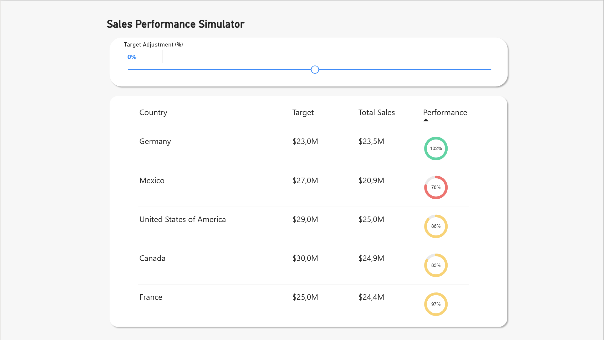
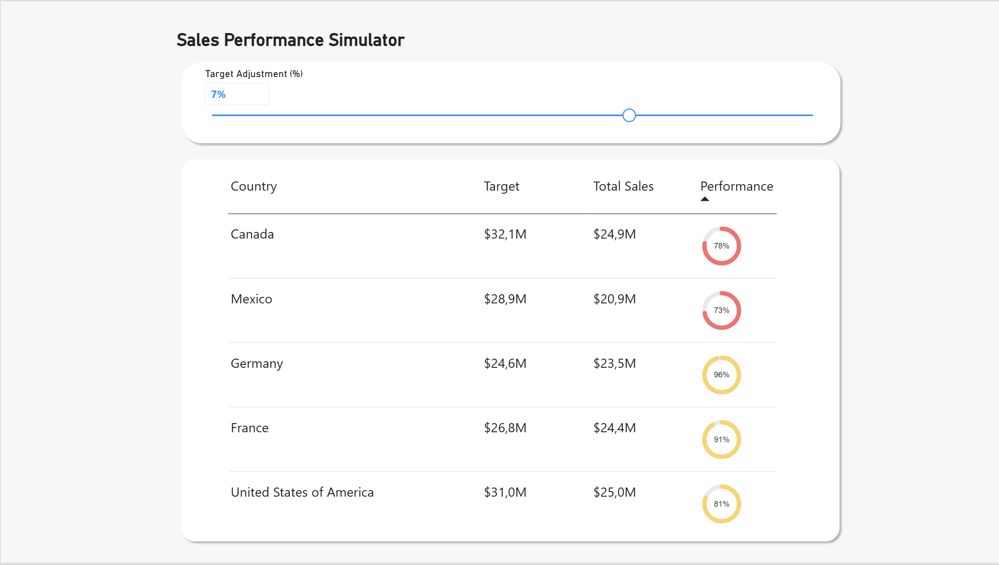

# Sales Performance Simulator | Interactive Data Viz

## Project Overview

This Power BI project was developed as an enhancement of the **Workout Wednesday** challenge [**"2026 Week 38 | Power BI: SVG Donuts"**](https://www.workout-wednesday.com/pbi-2026-w38/) by [Fotiana Yan](https://www.linkedin.com/in/fotiana-yan/?isSelfProfile=false).

The original challenge used a global target controlled by a dynamic slider and focused on building dynamic SVG progress rings inside a standard Power BI table visual without using custom visuals.

To create a more realistic business scenario, I extended the original concept by introducing country-specific sales targets and scenario-based target simulation using a What-If parameter.
My Enhancements:

- Country-specific sales targets
- Country dimension table
- What-If target adjustment parameter
- Dynamic target recalculation
- Sales target scenario simulation

This approach better reflects how sales targets are commonly managed in real-world performance reporting.

## Business Scenario
A sales manager wants to understand how changes in sales targets affect country-level performance.

Users can increase or decrease sales targets through a dynamic parameter and instantly evaluate achievement levels across different markets.

## Key Features

- **Dynamic What-If parameter**
- **Country-level target management**
- **Interactive scenario analysis**
- **SVG-based KPI indicators**
- **Conditional performance colouring**
- **Native Power BI visuals only**
- **Star-schema data model**
- **DAX-driven calculations**

## Data Source

**Dataset**: [GitHub](https://github.com/Imba456/Workout-Wednesday-for-Power-BI/blob/main/datasets/Financial%20Sample.xlsx)

## Tools & Technologies

- **Python/Jupyter Notebook** - Data preprocessing and documentation
- **PowerBI Desktop** - Data modeling and visualization

## Dashboard Preview
### Default Scenario (+0%)

### Target Adjustment (+7%)

## Getting Started

### Installation & Usage

1. **Clone the repository**

2. **Open** sales_performance_simulator.pbix in **Power BI Desktop**

3. **Explore the Report**
   - Interact with the Target Adjustment (%) parameter
   - Analyze how changes in sales targets impact Country-level performance
   - Review the SVG KPI indicators to compare achievement across markets

## Methodology

1. **Data Preparation:** Cleaned and transformed the original dataset using Python and Jupyter Notebook.
2. **Data Modeling:** Built a star-schema model with separate Country and Target tables.
3. **Target Design:** Created country-specific sales targets to simulate a more realistic business scenario.
4. **Scenario Simulation:** Implemented a What-If parameter to dynamically adjust targets and evaluate alternative performance scenarios.
5. **KPI Development:** Calculated achievement percentages using DAX measures and dynamic target recalculation.
6. **SVG Generation:** Built custom SVG donut indicators directly in Power BI using DAX-generated SVG code.
7. **Visualization & Interaction:** Designed an interactive dashboard with dynamic filtering and real-time scenario analysis.

## Author

**Sara Magni**  
*Data Analyst*

[sara.m4gn1.data@gmail.com](mailto:sara.m4gn1.data@gmail.com) | [LinkedIn](https://www.linkedin.com/in/sara-m4gn1/) | [GitHub](https://github.com/Sara-Magni)

## Acknowledgments
Inspired by [**"2026 Week 38 | Power BI: SVG Donuts"**](https://www.workout-wednesday.com/pbi-2026-w38/) by [Fotiana Yan](https://www.linkedin.com/in/fotiana-yan/?isSelfProfile=false).

---

**Note**: This dashboard uses synthetic data and is intended for educational and analytical demonstration purposes only.
